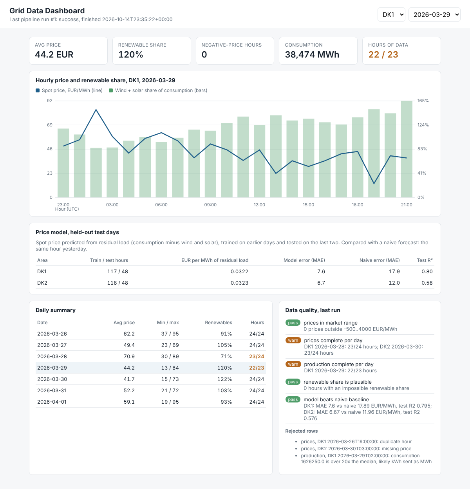

# Grid Data Pipeline

An hourly data pipeline for the Danish power market. It takes day-ahead spot
prices and consumption/renewable production for the two Danish price areas
(DK1 and DK2), cleans them, checks their quality, builds analysis tables and
serves them through a small JSON API. Every run is logged, so you can see what
ran, how many rows it wrote and which checks failed.

```
raw_prices ------> stg_prices ------\                 /--> mart_daily --\
                                     >--> mart_hourly                   >--> JSON API + dashboard
raw_production --> stg_production --/                 \--> price_model -/
                        |
                  rejected_rows (with a reason for every row)
```



Python 3.11+ standard library only (`sqlite3`, `zoneinfo`, `http.server`,
`unittest`), so it runs anywhere with no setup.

## Run it

```bash
python -m gridpipe run          # materialize every asset, run the checks
python -m gridpipe serve        # dashboard and API on http://127.0.0.1:8000
python -m unittest discover -s tests -v
```

Output of a run on the sample data:

```
  ok     raw_prices                   334 rows
  ok     stg_prices                   332 rows
    pass  prices_in_market_range: 0 prices outside -500..4000 EUR/MWh
    warn  prices_complete_per_day: DK1 2026-03-28: 23/24 hours; DK2 2026-03-30: 23/24 hours
  ok     raw_production               334 rows
  ok     stg_production               333 rows
    warn  production_complete_per_day: DK1 2026-03-29: 22/23 hours
  ok     mart_hourly                  331 rows
    pass  renewable_share_is_plausible: 0 hours with an impossible renewable share
  ok     mart_daily                    14 rows
Run 1: success
```

## The data

`data/sample/` holds one week (26 March to 1 April 2026) in the same
format as two Energi Data Service datasets, Elspotprices and
ProductionConsumptionSettlement (field names simplified), so a real export
can be dropped in by pointing `GRIDPIPE_DATA` at it. The sample values are
generated by `gridpipe/sample.py`: realistic shapes (daily demand curve,
wind arriving in fronts, solar in daylight, prices falling when wind is high)
but not real market data.

The sample deliberately contains four faults that real feeds have:

| Fault | What the pipeline does |
|---|---|
| An hour delivered twice | Keeps the first, moves the copy to `rejected_rows` |
| An hour missing | Completeness check reports exactly which area and day |
| A null price | Moved to `rejected_rows` as "missing price" |
| Consumption sent in kWh instead of MWh (1000x too big) | Detected against the area's median, quarantined, not "fixed" by guessing |

## Design decisions

**Runs in Dagster too.** `gridpipe/dagster_defs.py` turns every asset and
check into a real Dagster asset and asset check with the same names and
dependencies, without changing the pipeline code:

```bash
pip install dagster dagster-webserver
dagster dev -m gridpipe.dagster_defs
```

CI installs Dagster and materializes the whole graph through it on every
push (`tests/test_dagster.py`).

**Assets with declared dependencies.** Each table is produced by one
function that declares what it reads (`gridpipe/assets.py`). The runner sorts
them, runs each once, and if one fails it skips everything downstream but
still runs unrelated assets. This is the model Dagster uses (software-defined
assets and asset checks); I wrote a small version to understand it from the
inside, and `dagster_defs.py` runs the same assets in Dagster itself.

**Blocking and non-blocking checks.** A price outside the market's own
limits blocks downstream tables, because publishing it would be wrong. A
missing hour only warns: the rest of the day is still useful, and the gap is
reported by name instead of hidden.

**Nothing is dropped silently.** Every row removed in staging lands in
`rejected_rows` with a reason, and `/quality` shows them. When someone asks
"why is this hour missing from the dashboard?", the answer is a query.

**Time is stored in UTC, reported in Danish local time.** Joins use the
UTC hour, so a DST change can never mismatch two feeds. Daily summaries use
the local date, because that is the day people mean.

## A bug worth writing down

The first version of the completeness check said 29 March had 24 hours, so
it reported the DST day as one hour short for both areas. The cause:
subtracting two Python datetimes that share the same `ZoneInfo` does
wall-clock arithmetic and ignores the DST jump. Converting both ends to UTC
before subtracting fixed it (`expected_hours` in `pipeline.py`), and the
test `test_normal_and_dst_days` pins 23, 24 and 25 hour days so it cannot
come back.

## Price model

`price_model` predicts the spot price from residual load (consumption minus
wind and solar), as an example of moving a data science prototype into the
pipeline instead of leaving it in a notebook. It is rebuilt on every run,
always tested the same way, and checked against a baseline:

- **Split by time.** The last two days are held out for testing and the model
  only learns from the days before them. A random split lets a model learn
  from the future, which is exactly the leakage bug I found in an earlier
  project, where it inflated R&sup2; from 0.475 to 0.996.
- **Baseline.** A model is only useful if it beats something simple, so it is
  compared with "the same hour yesterday". The check `model_beats_naive_baseline`
  warns if it ever stops doing so.

On the sample data: DK1 MAE 7.6 EUR/MWh (naive 17.9), test R&sup2; 0.80;
DK2 MAE 6.7 (naive 12.0), test R&sup2; 0.58. These numbers are flattering
because the sample prices are generated from residual load; on real market
data a one-variable model will do worse, and the point here is the
evaluation setup, not the score. Results are at `/model` and on the dashboard.

## Dashboard

`http://127.0.0.1:8000/` is a small dashboard for people who use the data,
built on the same API: pick an area and a day to see the hourly price against
the wind and solar share, the daily summary (days with missing hours are
highlighted), and the data quality results with every rejected row and its
reason. It is plain HTML and JavaScript, with the chart drawn as SVG, so it
needs no build step.

## API

| Endpoint | |
|---|---|
| `GET /health` | Status of the last run (503 if the pipeline never ran) |
| `GET /hourly?area=DK1&date=2026-03-29` | Hourly price, consumption, wind, solar, renewable share, residual load |
| `GET /daily?area=DK2` | Daily average/min/max price, negative-price hours, renewable share, hours covered vs expected |
| `GET /quality` | Rejected rows and the latest check results |
| `GET /model` | Price model metrics per area and its predictions on the test days |
| `GET /runs` | Last 20 runs with per-asset rows, duration and errors |

The API opens the database read-only and validates its inputs (`area=SE3`
returns 400 with a clear message).

## Docker

```bash
docker build -t grid-data-pipeline .
docker run -p 8000:8000 grid-data-pipeline   # dashboard on http://localhost:8000
```

The image runs the pipeline on the sample data at build time, runs as a
non-root user, and has a health check on `/health`. CI builds it and checks
that the API and dashboard respond.

## Tests and CI

16 tests: DST hour counts, dependency ordering, cycle detection, failure
isolation, blocking checks, every planted fault caught with the right reason,
mart consistency, a model that is only tested on later days and beats the
baseline, run logging, and HTTP tests against a live server (API, model
endpoint and dashboard). GitHub Actions runs three jobs on every push and
weekly: the tests plus a full pipeline run on Python 3.11 to 3.13, the whole
graph materialized through Dagster, and a Docker build with a smoke test.

## Next steps

- Fetch directly from the Energi Data Service API on a schedule
- Dagster schedules and sensors for hourly runs
- Incremental loads (only new hours) instead of full rebuilds
- Power BI or Grafana on top of `mart_daily`
